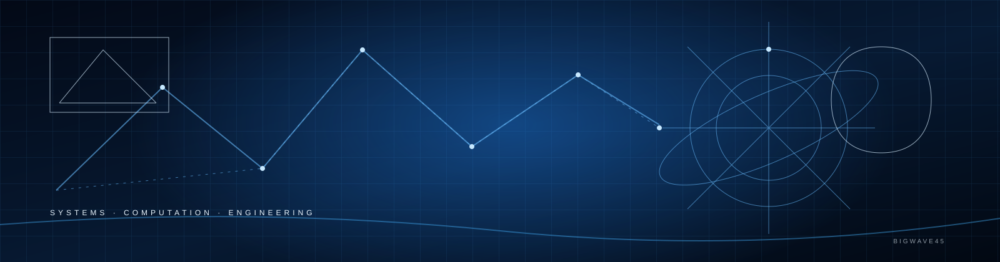

<!-- Profile README for BigWave45 -->

  
   
  
  <h1>BigWave45</h1>
  
<strong>Independent Systems Builder</strong>

  
Building software around computation, protocols, and economic systems.

  

    <a href="https://x.com/maxlensherr">X</a> ·
    <a href="https://www.linkedin.com/in/damilola-ademodi-417346b9/">LinkedIn</a> ·
    <a href="https://github.com/BigWave45">GitHub</a>
  

---

## Focus

I work across software engineering and applied research, with an interest in how rules, incentives, and computational processes can be translated into systems that operate reliably.

- **Systems engineering:** application architecture, transaction flows, verification, and operational boundaries.
- **AI and autonomous systems:** agent permissions, execution controls, and accountable use of shared resources.
- **Protocols and economic mechanisms:** settlement, ownership, accounting, and incentive design.
- **Computational research:** mathematical models, simulations, and evidence-driven technical investigation.

## Selected work

| Project | What it explores | Status / evidence |
|---|---|---|
| [Pelargo](https://github.com/BigWave45/Pelargo) | Cross-chain merchant checkout with NEAR as the settlement base. | [Judge demo](https://main.pelargo.pages.dev/judge-demo) · [Project site](https://main.pelargo.pages.dev) |
| [ENCU](https://github.com/BigWave45/Encu) | Application-level authorization and accounting for autonomous-agent payments. | Testnet implementation; see repository for architecture and limitations. |
| [Canton Research Lab](https://github.com/BigWave45/canton-research-lab) | Research into verifiable accounting for dedicated synchronizer paymasters. | Paper, models, tests, and evidence boundaries in the repository. |
| [Teshio Protocol](https://github.com/BigWave45/-TESHIO-PROTOCOL) | Experimental Gno protocol separating principal ownership from future fee rights. | Prototype; not yet deployed or validated on Onyx. |
| [BEYOND](https://github.com/BigWave45/Beyond) | An interactive environment for exploring mathematics, science, and computational ideas. | Early development. |

## Research interests

Computational models · Mechanism design · Financial systems · Autonomous agents · Distributed systems · Verification and accounting.

## Elsewhere

- [X](https://x.com/maxlensherr)
- [LinkedIn](https://www.linkedin.com/in/damilola-ademodi-417346b9/)
- [GitHub](https://github.com/BigWave45)

For collaboration or technical discussion, reach out through one of the profiles above.
